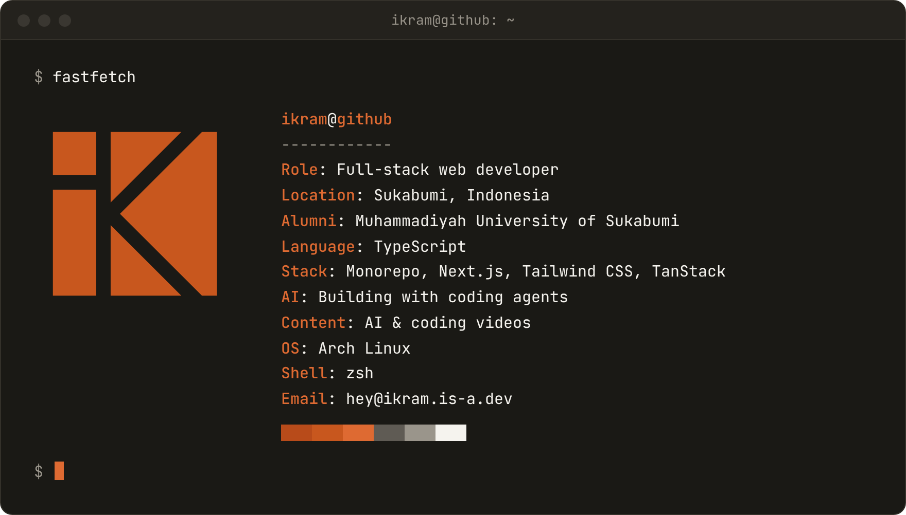

<picture>
  <source media="(prefers-color-scheme: dark)" srcset="assets/banner-dark.png" />
  
</picture>

# Hi, I'm Ikram 👋

I'm a full-stack web developer from Sukabumi, Indonesia. I mostly write TypeScript, and lately I spend a lot of time building small tools with AI. I also make short videos about AI and coding on [Instagram](https://www.instagram.com/heyikramdev/).

If you want to talk shop, find me on [LinkedIn](https://www.linkedin.com/in/ikram-maulana) or send an [email](mailto:hey@ikram.is-a.dev).

## Selected work

- **[claude-seo-pi](https://github.com/Ikram-Maulana/claude-seo-pi)**: SEO analysis for the pi and omp coding agents, ported from claude-seo. 
- **[kfwd](https://github.com/Ikram-Maulana/kfwd)**: CLI and TUI for managing named `kubectl port-forward` rules as background processes. Published as [kfwd on npm](https://www.npmjs.com/package/@ikrammaulana/kfwd).
- **[kakureta](https://github.com/Ikram-Maulana/kakureta)**: small Hono API that keeps Umami Analytics working when ad blockers get in the way. See the [kakureta live demo](https://kakureta.ikram.is-a.dev).
- **[guest-book](https://github.com/Ikram-Maulana/guest-book)**: guestbook built with Next.js, NextAuth, tRPC and Redis.

## Tech

<!--START_SECTION:waka-->

<!--END_SECTION:waka-->
